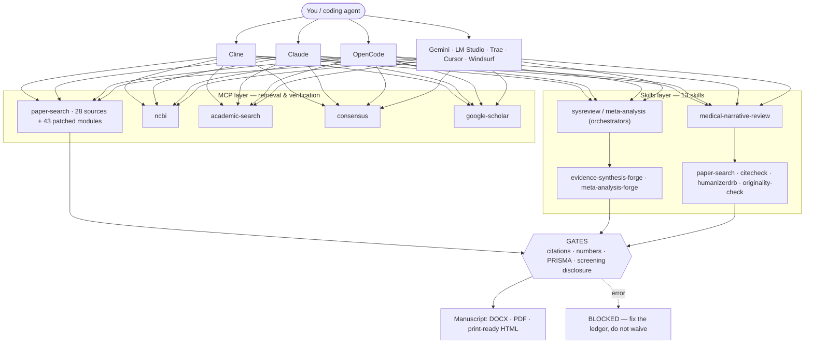
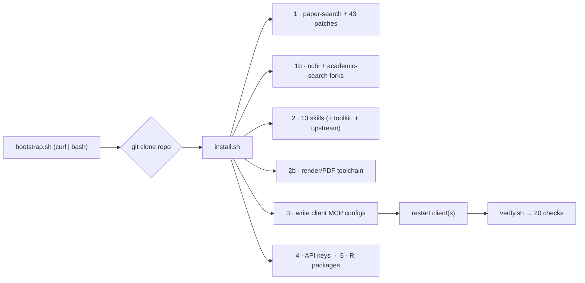
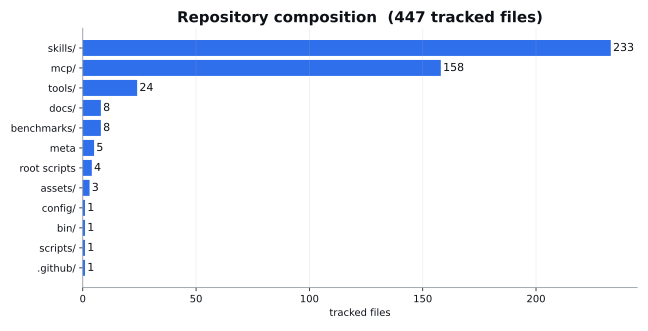
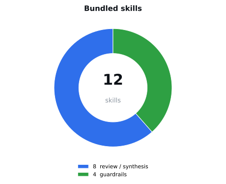
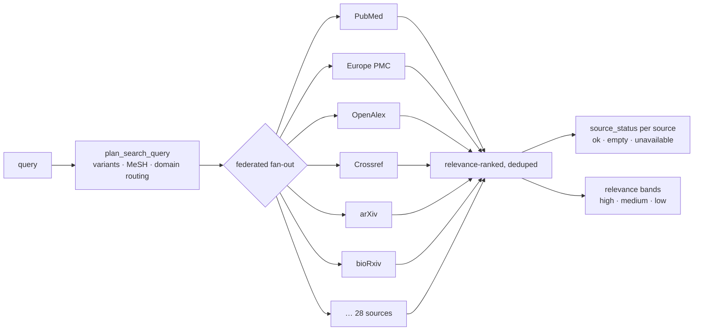
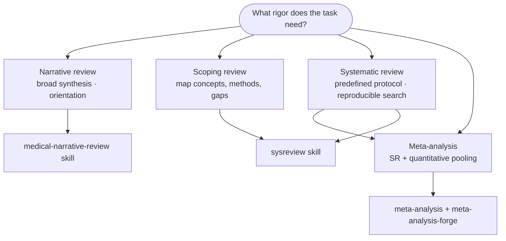
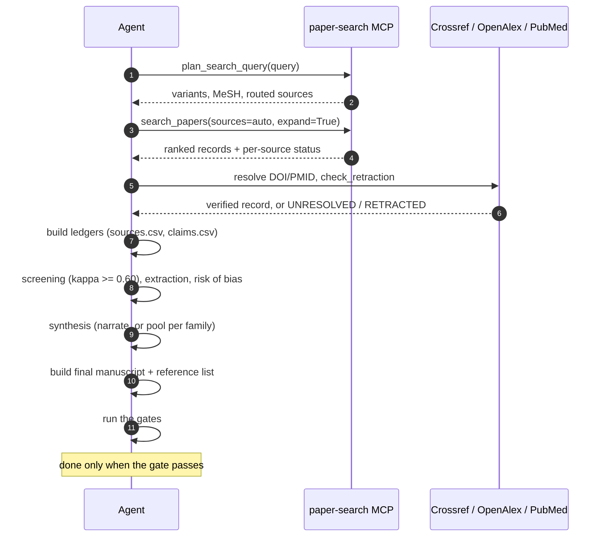
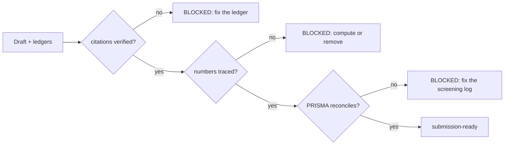
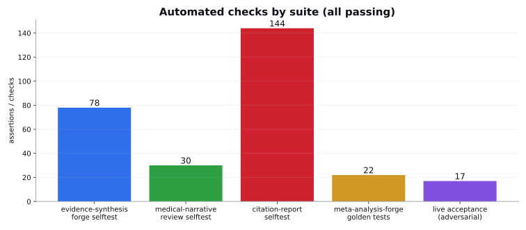
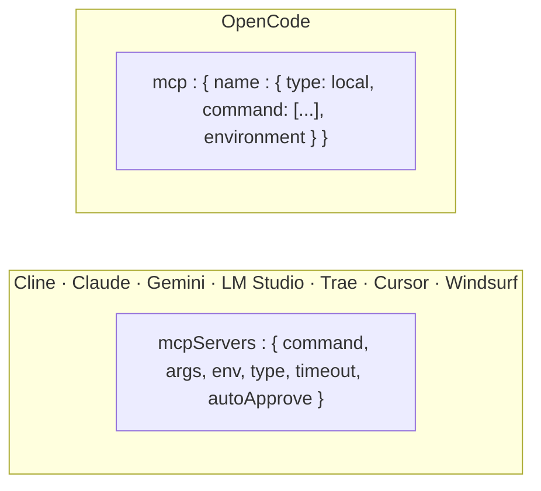

<div align="center">

# research-stack

**Reliable literature-review tooling for AI coding agents.**
The search MCP servers **plus** the systematic / scoping / narrative-review and
meta-analysis skills — installed in one command and wired into Cline, Claude, OpenCode and more.

Built for one promise: **no false citations, no hallucinated numbers, no silent empty searches.**

[](LICENSE)
[](#requirements)
[](#the-mcp-layer)
[](#the-skills-layer)
[](#verification--testing)
[](https://github.com/drb253/research-stack/actions/workflows/ci.yml)
[](#install)

</div>

> **TL;DR** — one command installs **5 MCP servers + 13 gated review skills** for
> Cline, Claude, OpenCode and more, so an agent can run a systematic / scoping /
> narrative review or a meta-analysis that **cannot cite a paper that does not
> exist, quote a number nobody computed, or report screening it never performed.**
> Zero keys needed to start; the three local MCP servers need **no network** (all vendored).

---

## Install (one command)

```bash
curl -fsSL https://raw.githubusercontent.com/drb253/research-stack/main/bootstrap.sh | bash -s -- \
  --targets cline,claude,opencode
```

Clones the repo to `~/.research-stack-src`, installs the MCP servers + skills, and
writes each selected client's config. Restart your client afterwards, then verify:

```bash
~/.research-stack-src/verify.sh --targets cline,claude,opencode
```

Prefer a clone?

```bash
git clone https://github.com/drb253/research-stack.git && cd research-stack
./install.sh --targets cline,claude,opencode --email you@org
```

### 60-second quickstart

```text
1  install        curl … | bash -s -- --targets cline,claude,opencode
2  restart        the client (MCP servers spawn only at startup)
3  verify         ~/.research-stack-src/verify.sh --targets cline,claude,opencode
4  use it         in the client, run:  /sysreview <research question>
```

`verify.sh` finishes with a single verdict — and it fails loudly rather than
guessing:

```text
RESULT: <n> passed, 0 failed
RESEARCH-STACK VERIFIED
```

---

## Contents

- [How it's different](#how-its-different)
- [Why this exists](#why-this-exists)
- [Architecture](#architecture)
- [Install (one command)](#install-one-command)
- [Install options](#install-options)
- [What gets installed](#what-gets-installed)
- [The MCP layer](#the-mcp-layer)
- [The skills layer](#the-skills-layer)
- [The review pipeline](#the-review-pipeline)
- [Correctness guarantees](#correctness-guarantees)
- [Verification & testing](#verification--testing)
- [Platforms](#platforms)
- [API keys & access (100% output)](#api-keys--access-how-to-get-100-output)
- [Worked example](#worked-example)
- [Command reference](#command-reference)
- [Updating](#updating)
- [Repository layout](#repository-layout)
- [Troubleshooting & FAQ](#troubleshooting--faq)
- [Security & privacy](#security--privacy)
- [Contributing](#contributing)
- [Roadmap](#roadmap)
- [Credits](#credits)
- [License & provenance](#license--provenance)

---

## How it's different

| Capability | Plain LLM | Search MCPs alone | **research-stack** |
|---|:---:|:---:|:---:|
| Finds literature | ⚠️ from memory | ✅ live | ✅ live · 28 sources |
| Every citation verified against the DOI | ❌ | ❌ | ✅ |
| Every number traceable to a computed artifact | ❌ | ❌ | ✅ |
| PRISMA flow reconciles with the search + screening logs | ❌ | ❌ | ✅ |
| Refuses retracted / unverified / non-included sources | ❌ | ❌ | ✅ |
| Honest disclosure of AI-run screening | ❌ | ❌ | ✅ |
| Refuses AI- / plagiarism-detector evasion | ❌ | ✅ | ✅ |

The value is not the prose — it is the **enforced chain** from a research
question to a verified, reproducible, submission-ready manuscript.

---

## Why this exists

General-purpose agents happily write a *fluent* review that cites a paper that
does not exist, quotes an effect size nobody measured, and reports a PRISMA flow
figure that contradicts its own screening log. This stack makes those failures
**impossible to pass silently**: every factual claim is chained to a
verified identifier, every number must trace to a computed artifact, and every
stage is a gate that fails loudly instead of filling a gap from memory.

| Principle | Enforced by |
|---|---|
| No citation enters the review until its DOI/PMID resolves and the title matches | `cross_verify_citations.py`, `audit_citations.py`, `validate_sources.py` |
| No number appears that was not computed by the analysis | `numbers_provenance.py`, `check_numbers.py` |
| PRISMA counts must reconcile with the search + screening logs | `prisma_flow.py`, `make_prisma_flow.py`, `check_ledger_completeness.py` |
| Retracted / unverified / non-included sources cannot be cited | retraction checks (Crossref · OpenAlex · PubMed) + ledger gates |
| Machine-run screening is never reported as human screening | `check_screening_disclosure.py` |
| Detector-evasion is refused by design | `humanizerdrb`, `citecheck`, `originality-check` |

---

## Architecture



The stack is deliberately layered: the **MCP layer** fetches and verifies raw
records; the **skills layer** turns them into gated, reproducible artifacts; the
**gates** are the single authority on whether a document is finished.

---

## Install options

```text
--targets LIST   cline,claude,opencode,gemini,lmstudio,trae,cursor,windsurf   (default: cline)
--minimal        skills + paper-search only (skip ncbi, academic-search, render, R)
--no-ncbi / --no-academic-search / --no-render / --no-r   skip one default step
--no-upstream-skills     skip the 160+ K-Dense scientific skills
--with-aipoch-skills     also clone AIPOCH medical-research-skills (460+, third-party, not gated)
--copy-skills    copy skills instead of symlinking
--reinstall      reinstall/upgrade the paper-search tool first
--with-runtime   also create the Python toolchain venv (scipy/pandas/...)
--email ADDR     NCBI / polite-pool email        (env NCBI_EMAIL)
--ncbi-key KEY   NCBI API key                    (env NCBI_API_KEY)
--s2-key KEY     Semantic Scholar key            (env S2_API_KEY)
--dry-run        print exactly what would happen, change nothing
-h, --help
```

Every step is **idempotent** and **non-destructive**: existing client configs are
backed up (`.bak.<timestamp>`) and only the managed MCP keys are merged in.



### Optional third-party skill packs

Beyond the 13 gated skills, two MIT-licensed packs can be added — they are
**cloned, not gated by research-stack**:

- **K-Dense scientific skills** — `--with-upstream-skills` (on by default), 160+ skills.
- **AIPOCH medical-research-skills** — `--with-aipoch-skills`, **460+** skills across
  **Protocol Design**, **Data Analysis** (differential expression, enrichment, immune
  infiltration, WGCNA, survival, ML feature selection), and **Academic Writing**
  (target-journal matcher, reporting-guideline checker, arXiv preflight, medical-English editor).

AIPOCH closes the biggest capability gap — **primary omics / bioinformatics data
analysis** — which the gated core does not cover. Install is a **sparse, blobless
checkout of `scientific-skills/` (~120 MB)**. Unlike our 13 skills, AIPOCH's
skills *generate code and advice* and carry **no verification gates**: treat their
output as a first draft to check, not a verified result.

---

## What gets installed

<div align="center">
  
  
</div>

| Layer | Contents |
|---|---|
| **MCP servers** | `paper-search`, `ncbi`, `academic-search` (**all three vendored, pre-patched**) + `consensus` / `google-scholar` (remote) |
| **Review skills** | `sysreview`, `meta-analysis`, `evidence-synthesis-forge`, `meta-analysis-forge`, `medical-narrative-review`, `umbrella-review-skeptic`, `meta-ml-screener`, `environment-life-review-forge` |
| **Guard skills** | `paper-search`, `citecheck`, `humanizerdrb`, `originality-check`, `citation-report` |
| **vendored MCP source** | `mcp/paper-search-mcp/` (upstream `v0.1.4` + 43 patched modules), `mcp/ncbi-mcp-server/`, `mcp/academic-search-mcp/` — installed with **no network** |
| **Toolbox & tools** | `originality-toolkit` (23 files), `verification_report.py` |
| **Render/PDF** | `browser-probe` venv — playwright + chromium, pypdf, pypdfium2, reportlab, pillow |
| **R engine** | metafor, meta, netmeta, robumeta, clubSandwich, robvis, esc, mvmeta, ggplot2 |
| **Upstream (optional)** | the 160+ K-Dense scientific skills, cloned (MIT), not vendored |
| **AIPOCH (optional)** | 460+ [AIPOCH medical-research-skills](https://github.com/aipoch/medical-research-skills) (protocol design · omics data analysis · academic writing), cloned (MIT), **not gated** |

### Requirements

- **macOS or Linux**, `git`, `curl`, `python3` (3.9+).
- `node`/`npx` 18+ — for the two remote servers (`consensus`, `google-scholar`).
- `uv` — installed automatically if missing.
- `R` — only for the meta-analysis engine; skipped with a warning if absent.

---

## The MCP layer

Five MCP servers give the skills their retrieval and verification surface.

| Server | Kind | What it adds |
|---|---|---|
| **paper-search** | local, `uv` tool | 28 sources (27 work with zero config), federated search, query planning, retraction check, citation export |
| **ncbi** | local, venv (vendored) | E-utilities: PubMed search, MeSH terms, related articles, batch fetch |
| **academic-search** | local, venv (vendored) | Semantic Scholar / Crossref / OpenAlex multi-provider search |
| **consensus** | remote (`npx mcp-remote`) | semantic search over 400M+ papers |
| **google-scholar** | remote (`npx mcp-remote`) | Google Scholar results, citations, case law |

`paper-search` fans a query out across sources concurrently, bounds each source
with a wall-clock budget, and **never reports a failed source as "no results"**:



> **Vendored, not fetched.** All three local servers ship complete in this repo —
> `mcp/paper-search-mcp/` (upstream `v0.1.4` + the 43 patched modules),
> `mcp/ncbi-mcp-server/`, and `mcp/academic-search-mcp/` — so the installer builds
> them from source with **no network** and never depends on PyPI or a moving
> upstream HEAD.

> **Audit fix included.** The MeSH query-planner previously expanded common words
> to a *subheading's* entry terms (e.g. `screening → diagnosis, signs, findings,
> symptoms`). It now reads NCBI's authoritative mapping (`screening → mass
> screening, early detection of cancer`); `audit_fix_check.py` proves it on every
> install.

---

## The skills layer

Twelve skills, each a folder with a `SKILL.md`. The orchestrators sequence the
others; each stage is gated and ledgered, and no stage is skipped.

| Skill | Role | Key artifacts |
|---|---|---|
| **sysreview** | end-to-end systematic/scoping/umbrella review entry point (`/sysreview`) | `sources.csv`, `claims.csv`, `search_log.csv`, `prisma_counts.json`, `GATE_REPORT.json` |
| **meta-analysis** | quantitative-synthesis entry point (`/meta-analysis`); poolability gate first | coding sheet → pooled estimate + forest/funnel plots |
| **evidence-synthesis-forge** | review orchestrator: protocol, search, screening, coding, reporting | PRISMA-S appendix, SoF tables, integrity gates |
| **meta-analysis-forge** | the statistics: effect sizes, models, heterogeneity, meta-regression | R engine (`cochrane_meta.R`), `golden_tests.R` |
| **medical-narrative-review** | publication-ready narrative review with a hard submission gate | verified reference list, evidence tables, DOCX/PDF/HTML |
| **umbrella-review-skeptic** | synthesis of existing reviews / second-order meta-analysis | overlap matrix, quality scorecard |
| **meta-ml-screener** | ML/LLM-assisted screening & extraction with audit logs | screening log (human decisions retained) |
| **environment-life-review-forge** | PECO/PICO domain adaptation (eco, environmental, life science) | domain schemas + audit templates |
| **paper-search** | how to drive the retrieval MCPs correctly | query routing, retraction, export |
| **citecheck** | audit & build citations; flag retractions | reference list in 7 styles; A1–A10 audit |
| **humanizerdrb** | de-slop prose without changing meaning | "What changed" list; refuses detector evasion |
| **originality-check** | attribution check for your own drafts | verified BibTeX + paraphrase worksheet; overlap against 5 open APIs **plus any local corpus** (`--corpus` covers paywalled PDFs, theses, books, unpublished manuscripts, saved web pages) |
| **citation-report** | sentence-by-sentence citation support report — *is the citation support actually there?* | colour-coded PDF / DOCX / HTML with printed margin notes, real Word comments, coverage `n/N`, and a gate that re-opens every artifact |

### What is the difference between `citecheck`, `originality-check` and `citation-report`?

Three different questions, three different tools, and mixing them up is how a "plagiarism-free"
claim quietly becomes meaningless:

| Question | Tool |
|---|---|
| Does this citation exist, is it retracted, and is the reference list correct? | `citecheck` |
| Does this passage closely track some published text, whatever it cites? | `originality-check` |
| Is the support this sentence claims from *these* sources actually there? | `citation-report` |

A sentence can be heavily paraphrased from an uncited source (invisible to `citation-report`), and a
verbatim quotation with a correct citation is properly attributed (invisible to `originality-check`).
`citation-report` answers neither of those: it checks the join between a sentence and the sources the
sentence cites, and it never certifies a document as citation-clean — it reports which sentences it
could check and which it could not.

### Choosing a review type



---

## The review pipeline



Each arrow is a **file on disk**. If a link is missing, the review is not
finished, and the gate says so explicitly rather than filling the gap.

---

## Worked example

> *Illustrative — the shape of a run, not a real dataset. Every number a real run
> prints is computed and traceable; none is invented.*

```
You:  /sysreview Do SGLT2 inhibitors reduce heart-failure hospitalisation?

  Stage 0  question + protocol ........ PICO locked, scope + PROSPERO draft
  Stage 1  registered search .......... plan_search_query → variants + MeSH + routing
  Stage 2  deduplicate ................ DOI → PMID → title
  Stage 3  screen (κ ≥ 0.60 gate) ..... title → abstract → full text
  Stage 4  extract .................... one row per effect, with a locator
  Stage 5  risk of bias ............... RoB 2 for RCTs, ROBINS-I otherwise
  Stage 6  synthesise ................. narrate (SWiM) or pool per effect family
  Stage 7  citation gate .............. every cited DOI resolves + title matches
  Stage 8  number gate ................ every value traced to results.json
  Stage 9  PRISMA figure .............. reconciles with search + screening logs
  Stage 10 manuscript ................. DOCX · PDF · print-ready HTML

  GATE  PASS   → submission-ready        (AI-assisted; CONDUCT_DISCLOSURE attached)
  GATE  FAIL   → BLOCKED                 (fix the ledger — never waive silently)
```

### The citation report, in one screen

`citation-report` answers a different question from the gate above — not "does this DOI resolve?"
but "is the support this sentence claims actually there?" — and shows the answer **next to the
sentence**:

```bash
python3 skills/citation-report/scripts/report.py report \
    --document draft.docx --bib refs.bib --pdf-dir sources/ \
    --format pdf,docx,html --out-dir citation-report/
python3 skills/citation-report/scripts/report_gate.py \
    --dir citation-report/ --document draft.docx
```

```
Citation coverage: 6/8 = 75.0%   ((attributed + synthesis) / all sentences carrying a claim)

STATE                 COUNT  SHARE
attributed                3   37.5%   every value is present in a cited source's evidence
synthesis                 3   37.5%   cited and resolvable; no independently checkable value
unverifiable              1   12.5%   cited and identified, but no evidence was held
unattributed              0    0.0%   a checkable claim with no resolvable citation
conflict                  1   12.5%   a citation that resolves to nothing, a retracted
                                      source, or a value that contradicts the source
no_citation_needed        0    0.0%   nothing to attribute; excluded from the denominator
```

Every sentence in the PDF carries its colour as a **painted background** and its finding as a
**printed margin note** naming the source, the page (`p.13`) and the quoted evidence — not an
annotation, so it survives printing and every viewer. The DOCX carries the same colour as exact
run shading plus a **real Word comment**. The gate then re-opens all three artifacts and counts what
is actually in them, including requiring the PDF's notes to be findable in its text layer.

It never paints green without evidence, never paints red without a quote, and never certifies a
document as clean: it reports which sentences it could check and which it could not.

**And it will not dress an input gap up as a result.** If the sources it needs are not readable, the run
is `insufficient_evidence` (**exit 3**) — not `0%` coverage in the shape of a verdict — and it writes a
worklist naming exactly which files to supply. A document it could not parse is `insufficient_input`
(exit 4). Both block by default. The rule, and why it exists, is
[`docs/EVIDENCE-INVARIANT.md`](docs/EVIDENCE-INVARIANT.md); it applies to every gate in this repo.

That rule has now been applied to the *tool* gaps as well as the document gaps. A PDF that cannot be
read reaches exit 4 with an `input_gaps[]` entry naming which of the three conditions it is — a scan,
no extractor installed, or a file an extractor cannot decode — and the line that closes it. The
"no extractor installed" route used to exit 1, the finding code, which meant a machine with no
`poppler` reported *"here is what is wrong with your document"* about a document nothing had read.
It was found by CI, which has no PDF extractor at all, failing a suite that passed on a developer
machine that had one.

**Scans are read, and the reading is labelled.** With an OCR engine and poppler's rasteriser
installed, a PDF with no usable text layer is transcribed rather than refused (on by default;
`--no-ocr` refuses instead). Two engines are supported — the `tesseract` binary and the optional
`rapidocr-onnxruntime` package — and `--ocr-engine` chooses, with the engine that ran named in the
provenance of everything it read. Everything read that way is marked: the document carries
`transcribed: true` and `transcription: <engine>`, a transcribed source's `evidence_origin` begins
`ocr:`, and all three artifact formats state how many sentences rested on a transcription. A
transcribed run is **`insufficient_evidence` (exit 3) by default** — a transcription is a machine's
reading, not the document's own text layer — and `--allow-insufficient` proceeds while the status
still says so.

**And a transcription can never convict.** A contradiction is an accusation, so it needs text that
was *read* on both sides: where either side came from OCR, rule `D13` discloses the disagreement as
`unverifiable` and names what would close the gap. That bar is not theoretical. On a real scan built
for the test, tesseract read `95% CI` as `95% Cl` — an upper-case I as a lower-case l — while
RapidOCR read the same page correctly, which is exactly why the engine is named and why a second one
is worth having. On the control fixture the same words with a text layer are still a `conflict`
(`D08`, exit 1) while the scan is `unverifiable` (`D13`, exit 3), so what changed the outcome is
provenance, not the value. Engine agreement does not lift the bar: the rule is about provenance, not
confidence.

The point is the last two lines: a review is finished **only** when the gate
passes, and the gate is a set of scripts that can each fail.

---

## Command reference

**`install.sh`** (also driven by `bootstrap.sh`):

| Flag | Effect |
|---|---|
| `--targets LIST` | `cline,claude,opencode,gemini,lmstudio,trae,cursor,windsurf` (default `cline`) |
| `--minimal` | skills + paper-search only |
| `--no-ncbi` · `--no-academic-search` · `--no-render` · `--no-r` | skip one default step |
| `--no-upstream-skills` | skip the 160+ K-Dense scientific skills |
| `--from-pypi` | install paper-search from PyPI + apply patches (legacy) |
| `--reinstall` | rebuild the vendored paper-search tool |
| `--copy-skills` | copy skills instead of symlinking |
| `--with-runtime` | also build the Python toolchain venv |
| `--email` · `--ncbi-key` · `--s2-key` | write API settings |
| `--dry-run` | print actions, change nothing |

**`verify.sh`** — `--targets LIST`, plus `--help`. **`publish.sh`** —
`--user <gh> [--repo] [--branch] [--no-push]`.

---

## Correctness guarantees

The gates are the authority. A gate that cannot fail is not a gate — so every one
is tested on **both** its pass and its fail path.



| Gate | Fails when | Script |
|---|---|---|
| Citation verification | a cited DOI is unresolved / retracted / resolves to a different paper | `cross_verify_citations.py` |
| Ledger verification | an included source is unverified, has no identifier, or a duplicate | `validate_sources.py` |
| Claim ↔ source join | a claim cites an unknown / unverified / excluded / retracted source | `audit_citations.py` |
| Number provenance | a number in the write-up is not traceable to a computed artifact | `numbers_provenance.py`, `check_numbers.py` |
| PRISMA reconciliation | the flow figure does not balance against search + screening | `prisma_flow.py`, `make_prisma_flow.py` |
| Ledger completeness | `removed_other` / `not_retrieved` are non-zero without a value-matched waiver | `check_completeness.py` |
| Screening disclosure | machine screening described as human, or no conduct disclosure | `check_screening_disclosure.py` |
| Appraisal honesty | a risk-of-bias tool is named but the appraisal is a placeholder | `check_appraisal.py` |
| Review integrity | template/placeholder leakage into a rendered deliverable | `check_review_integrity.py` |
| Gate coverage | any gate is exercised on only one path | `check_selftest_coverage.py` |
| Sentence-level support | a recorded verdict no longer locates its own sentence, the coverage arithmetic disagrees with the verdict list, or a rendered artifact does not actually contain the notes it claims | `citation-report/scripts/report_gate.py` |
| Evidence invariant | a missing input is presented in the same status, shape or colour as a finding about the document | `citation-report/scripts/sufficiency.py`, `preconditions.py` |
| Retrieval availability (MCP) | a lookup that failed because a source was unreachable is reported as "no results found" instead of unavailable | `paper-search-mcp` openaire/unpaywall, `ncbi-mcp-server` MeSH, `academic-search-mcp` providers |
| Analysis completeness (engine) | rows the engine could not use are dropped and the remainder is pooled in the shape of a complete run | `meta-analysis-forge/scripts/cochrane_meta.R`, `run_meta_analysis.R`, `forest_funnel.R` |
| Assessable input (guard skills) | a draft or ledger the tool cannot analyse is reported as clean | `humanizerdrb/scripts/humanizer_check.py`, `meta-ml-screener/scripts/validate_screening_log.py` |
| Acceptance (live) | any adversarial case (retracted DOI, unregistered DOI, false human-screening claim, stale waiver, mixed estimands) does **not** fail | `acceptance_test.py` |

---

## Verification & testing

<div align="center"></div>

**301 automated checks, all passing.** Run them after any change:

```bash
S=~/.research-stack/skills
bash  $S/evidence-synthesis-forge/scripts/doctor.sh              # toolchain report
bash  $S/evidence-synthesis-forge/scripts/selftest.sh            # 78 — every gate, pass+fail
Rscript $S/meta-analysis-forge/scripts/golden_tests.R           # 22 — engine vs metafor
bash  $S/medical-narrative-review/scripts/selftest.sh           # 30 — narrative-review chain
bash  $S/citation-report/scripts/selftest.sh                    # 154 — citation report, pass+fail
python3 $S/evidence-synthesis-forge/scripts/acceptance_test.py  # 17 — live adversarial
./verify.sh --targets cline,claude,opencode                      # install acceptance
```

The citation-report suite is written for **three** PDF environments, because the expected behaviour
changes with the tools installed, and a suite that assumed one of them failed on CI:

| environment | unreadable PDF | suite |
|---|---|---|
| CI: no `pdftotext`, no `pypdf`, no OCR engine | `no_pdf_extractor`, exit 4 | **137 passed, 0 failed** |
| a machine with a text extractor, no OCR engine | `no_text_layer`, exit 4, names the install route | **139 passed, 0 failed** |
| a machine with OCR (tesseract + poppler) | transcribed, labelled, input-bound by default, never an accusation | **154 passed, 0 failed** |

`CITATION_REPORT_PDF_EXTRACTOR=none`, `CITATION_REPORT_OCR=none` and
`CITATION_REPORT_OCR_ENGINES=none` force the absent branches, so any machine can exercise all
three — and a fourth environment, an engine with no rasteriser, is its own gap
(`no_pdf_rasterizer`). Both unreadable routes are asserted to exit 4 rather than 1.

`verify.sh` reports the **gated core strictly** (pass/fail on the 13 skills) and
lists any installed **third-party packs** (K-Dense / AIPOCH, with AIPOCH broken
down by category) as *informational* — they never change the verdict.

The vendored MCP servers have their own gate, run by CI on every push:

```bash
python3 mcp/paper-search-patches/ci_patch_check.py   # patch system + availability invariant
python3 mcp/paper-search-patches/ci_patch_check.py --self-test
```

It copies the vendored package into a temporary directory, runs the real patch pipeline against that
copy, checks the fixes are present, then **mutates** the copy to reintroduce the defect the
availability layer exists to prevent and asserts the suite still rejects it. It needs `requests`; if
that is missing it exits 4 with a worklist rather than reporting success. What it does not do is
reconstruct the fixed files from pristine upstream `0.1.4` — the vendored copy is already in the
patched state, so the patch run is idempotent by construction. It catches drift, breakage and a
toothless suite; it does not re-derive the patch.

The engine is checked against `metafor`'s canonical datasets (`dat.bcg`,
`dat.normand1999`) plus closed-form maths, so a pooled estimate, τ², I² and Q are
never merely "plausible" — they are reproduced. The live acceptance run
deliberately tries to break each guard (a **real** retracted DOI, an unregistered
DOI, a false human-screening claim, an unwaived completeness gap, a stale
waiver, mixed estimands): every adversarial case **must fail**, and the run
passes only when each one does.

### Measured results

Most tool READMEs tell you *which* checks exist. This section tells you *how well
they work* — because "the gate ran" and "the gate was right" are two different
claims, and only the second one matters when a citation is about to go into a
manuscript.

Every number below comes from running this code against **answers we already
knew**, where those answers were taken from a source *other than the tool itself*.
Nothing here is estimated, and nothing is taken on trust: each figure is produced
by a script in [`benchmarks/`](benchmarks/) that you can run yourself, on your own
machine, in a few minutes.

#### First, the two words that matter

Almost everything below is summarised by two numbers:

- **Sensitivity — "did we catch the bad ones?"** Out of every genuinely retracted
  paper we tested, how many did the gate flag? **Missing one is the dangerous
  error**: it means a retracted paper could be cited as though it were sound.
- **Specificity — "did we leave the good ones alone?"** Out of every sound paper
  we tested, how many did the gate correctly *not* flag? **Getting this wrong is
  the annoying error**: legitimate work gets blocked, and you waste an afternoon
  chasing a false alarm.

A tool that flags everything scores 100% sensitivity and is worthless — so the two
numbers are only meaningful together. Both are reported for every component.

#### The results

| What was measured | Cases | Caught the bad (sensitivity) | Left the good alone (specificity) |
|---|:--:|---|---|
| **Retraction detection** — real citations, labels from the US National Library of Medicine | 920 | **100%** — 459 of 459<br><sub>95% CI [99.17%, 100%]</sub> | **100%** — 457 of 457<br><sub>95% CI [99.17%, 100%]</sub> |
| **Citation resolution** — did the DOI actually resolve to a real paper? | 920 | 99.6% — 916 of 920 resolved<br><sub>95% CI [98.9%, 99.8%]</sub> | — |
| **Arithmetic gate** — manuscripts with deliberate number errors | 17 | **100%** — 8 of 8 errors found<br><sub>95% CI [67.6%, 100%]</sub> | **100%** — 9 of 9 clean texts passed<br><sub>95% CI [70.1%, 100%]</sub> |
| **Overlap detection** — real preprint → published pairs | 61 pairs<br><sub>54 audited positives</sub> | **100%** — 54 of 54<br><sub>95% CI [93.4%, 100%]</sub> | **100%** — 61 of 61<br><sub>95% CI [94.1%, 100%]</sub> |
| **Overlap detection** — labelled stress set (verbatim, light edits, rewrites) | 186 | **100%** — 120 of 120<br><sub>95% CI [96.9%, 100%]</sub> | **100%** — 66 of 66<br><sub>95% CI [94.5%, 100%]</sub> |
| **Agreement with the US ORI guide's** own expert verdicts | 6 | **6 of 6**<br><sub>95% CI [61%, 100%]</sub> | — |
| **Citation gate** — did the sentence need a source at all? Sentences drawn from a real 34-page clinical review the rules were *not* written against | 40 | **86.7%** — 26 of 30 genuine gaps caught<br><sub>95% CI [70.3%, 94.7%]</sub> | **100%** — 10 of 10 sound sentences left alone<br><sub>95% CI [72.2%, 100%]</sub> |

**In plain terms:** across 920 real citations, the gate **never once let a bad
citation through** — zero missed retractions, zero false alarms, and zero cases
where a DOI resolved to the wrong paper without being flagged. That figure is
**0 unsafe accepts out of 920**.

On the citation-gate row the framing inverts in a way worth knowing: there the
dangerous error is the **false accusation** — telling an author they needed a
citation when they did not — so its relevant number is the specificity, **40 of
40**. The 4 misses out of 30 run the other way and under-report rather than accuse.
All four are multi-clause subjects that the signal rule deliberately refuses to
reach across, because reaching further was measured to cost true negatives:

> "Developmental trauma research in children and adolescents with childhood
> maltreatment (CM) histories provides…" · "A large study of postpartum women
> addressed this gap by examining…" · "One approach interprets scores at or above
> as indicative…" · "High-dose psilocybin produced marked improvements…"

The miss rate is published rather than tuned away: the rule needs the evidence noun
and its reporting verb within four words of each other, and a sentence whose
subject swallows a whole clause will slip past. Widening the window is the obvious
next experiment, and it is a trade to be measured, not assumed.

#### Why you can trust the labels

The hard part of any accuracy claim is the answer key. If the tool grades its own
homework, the number is meaningless. So the answers came from elsewhere:

- **Retraction** was judged against the **US National Library of Medicine's** own
  curated publication types (`Retracted Publication`), assigned by NLM librarians —
  *not* from OpenAlex or Crossref, which is what the gate itself reads.
- **Paraphrasing** was judged against the **US Office of Research Integrity's**
  published guide, which sets out six rewrites of one paragraph with the ORI's own
  verdicts (four it calls plagiarism, two it calls correct).
- **Overlap on real text** uses **61 genuine bioRxiv/medRxiv preprint → published
  journal pairs** — real authors revising real manuscripts, not transformations
  written by me. That benchmark also audits its own labels: it measures the actual
  text overlap independently, because "preprint vs published" turned out **not** to
  guarantee shared wording (7 of 61 published abstracts were heavily rewritten).

#### What the confidence intervals mean

You will notice the measurements say 100% while the intervals start lower, at
99.17%. That is not hedging — it is arithmetic, and it is the honest way to report
a sample.

A **95% confidence interval** answers: *"if this experiment were repeated many
times, where would the true value fall?"* We tested 920 papers. We got everything
right. But 920 papers is a sample, not the entire literature, so the statistics can
only promise that the real-world rate is **at least 99.17%** — not that it is
exactly 100%. Hence the claim is *"99%+"*, never *"perfect"*.

The sample size was chosen deliberately for that. To claim "at least 99%" with 95%
confidence after a flawless run, you need **at least 381 cases**. This benchmark
used 459 retracted and 457 sound papers — comfortably past the bar. A study of only
50 papers could also show 100% and would justify a claim of just ~94%. That is why
the count is stated next to every number.

#### External validation

`benchmarks/bench_ori_guide.py` checks the overlap detector against the ORI guide's
own paraphrasing exercise. All six of the ORI's verdicts are reproduced — the four
it calls plagiarism are flagged, the two it calls correct are left clean. That is a
rare thing to be able to say: the tool agrees with an external authority's
hand-labelled judgement, not just with our own expectations.

#### The citation gate, measured the same way

`citation-report` is the newest component, and it gets the same treatment rather
than a pass on the strength of its own test suite. `benchmarks/bench_verdicts.py`
runs the **real CLI** against labelled sentences and prints the same confusion
matrices and intervals:

| What was measured | Cases | Accuracy | Sensitivity | Specificity |
|---|:--:|---|---|---|
| Every state, one against the rest — cases written to exercise each rule | 48 | **100%**<br><sub>[92.6%, 100%]</sub> | 100% per class | 100% per class |
| **The accusation decision** — is a citation being called false? | 48 | **100%**<br><sub>[92.6%, 100%]</sub> | **100%**<br><sub>[87.1%, 100%]</sub> | **100%**<br><sub>[85.1%, 100%]</sub> |
| The trigger — does the sentence need attribution? Constructed cases | 48 | **100%**<br><sub>[92.6%, 100%]</sub> | **100%**<br><sub>[91.6%, 100%]</sub> | **100%**<br><sub>[61.0%, 100%]</sub> |
| The trigger — the same question on 40 unseen real sentences | 40 | **90.0%**<br><sub>[76.9%, 96.0%]</sub> | **86.7%**<br><sub>[70.3%, 94.7%]</sub> | **100%**<br><sub>[72.2%, 100%]</sub> |
| The accusation path on those real sentences (all 40 are true negatives) | 40 | **100%**<br><sub>[91.2%, 100%]</sub> | n/a — that text holds no contradiction | **100%**<br><sub>[91.2%, 100%]</sub> |

The **conflict** class is the one that accuses someone, so its interval is the number
to judge the gate by — and it was the weakest here, because four positives is too few
to tell "the rules work" from "the rules worked four times". It now holds **26**
positives, reaching the same decision through mechanisms that fail differently:
eight effect measures (HR, RR, OR, MD, SMD, IRR, PR, beta), each contradicted in both
directions, a contradiction that *reverses* the direction of the recorded effect,
retraction where the quoted figure is correct, and citation numbers the reference
list cannot account for. All 26 classify correctly, so precision stays 1.000 and its
Wilson lower bound moves **0.510 → 0.871**.

**Two more properties are asserted with them**, because "the gate found nothing" and
"the gate invented something" are different failures:

```
  conflict precision is 1.000 over 26 conflict case(s) -- no false accusation
  trigger specificity is 1.000 over 40 unseen real sentences -- no sentence was
    told it needs a citation when it did not
  0 of 4 ordinary-prose probes were accused -- the parser never invented a measure
  10 of 10 real-source contradictions caught -- no contradiction in the externally
    grounded set was missed
```

The last two lines answer the objection this section would otherwise invite. The
hand-written set was written by the author of the rules, so a second conflict set was
built whose **ground truth is the literature**: ten contradictions, each value copied
verbatim out of a real open-access article fetched through the tool's own acquisition,
each sentence a plausible digit transposition of it, with the article's own wording
recorded beside it. Yield, stated plainly: 19 of 60 DOIs from a real clinical
bibliography were obtained (31.7%, all from the Europe PMC tier) and only 4 of those
contain a measure the parser accepts. Building it immediately found a defect — the same
statistic written `relative risk` on one side and `RR` on the other was not recognised
as the same measure, losing two of ten — so a canonical measure vocabulary now runs on
both sides, and it went from 8 of 10 to **10 of 10**.

The "ordinary prose" line exists because the reverse error is worse. The English
conjunction **"or"** was being read as the odds-ratio label `OR`, so

```text
"Treatment continued for 6 or 12 weeks at the clinician's discretion [src:S006]."
cited against a source recording  OR 1.42
```

was reported as a **conflict** — an accusation, produced by the word "or" and the number
12. Three guards now prevent it, and the benchmark runs four such probes through the real
CLI and fails if any is classified as a contradiction. A missed measure is a recall cost;
an invented one is an accusation.

Calling a citation false is the one output that accuses someone, so precision
leads and is *structurally* enforced: no contradiction may stand unless the link
is exact **and** the evidence is primary or a recorded value. A number merely
*absent* from extracted evidence is a warning, never a conflict, because PDF
extraction routinely loses tables and figures. The price is reported rather than
hidden — **conflict recall falls** by design, and the three cases that decide the
bar (verbatim ledger value, the extractor's own prose, a title-only link) are each
pinned in the benchmark.

The metrics have already paid for themselves twice, by finding defects that
inspection did not:

- **A silent trigger gap.** The first measurement scored the trigger at accuracy
  **0.475 / sensitivity 0.300** on real prose: it never accused wrongly but missed
  70% of sentences that did need a citation, because the rules required exact
  phrases. A named body of evidence plus a reporting verb, associational claims and
  statistical nouns are now recognised. That moved the score to **0.900 / 0.867**
  with specificity still 1.000 — and on the real 1,027-sentence document it
  unmasked **132 attribution-requiring sentences** the old rules had been
  ignoring (`no_citation_needed` fell 656 → 524).
- **Twelve false greens**, the opposite and worse error. `attributed` means every
  distinctive value in the sentence was confirmed in a cited source. On the real
  document **11 of 12 `attributed` verdicts rested on the digits of `ICD-11` or
  `DSM-5`**, and the twelfth on a protein name — sentences reported as supported on
  the strength of a value never checked. Numbered labels and structural pointers
  (`Figure 2`, `phase 2`, `metalloproteinase 9`) are no longer read as statistics.
  That document's green count is now **zero**, which is the correct answer: with no
  source texts held, no sentence's value could be confirmed.

#### The honest limit of the citation gate — state this when you report it

Both of the above matter, but the limit matters more. **What the gate can say is
bounded by what it was given.** Grading a real 1,027-sentence clinical review
against its own 62-source bibliography, with no source documents supplied and the
network switched off, produces:

| State | Sentences | Share |
|---|---:|---:|
| `no_citation_needed` | 524 | 51.0% |
| `unattributed` | 306 | 29.8% |
| `unverifiable` | 197 | 19.2% |
| `synthesis` | **0** | 0% |
| `attributed` | **0** | 0% |
| `conflict` | 0 | 0% |

Every cited sentence is `unverifiable`, because a citation that cannot be checked
is not a citation that passed. The zeros are **not a clean bill of health and not a
failure** — they are what "no evidence was supplied" looks like.

Let the tool fetch open-access copies itself and the picture changes, without a
single rule changing. Same document, same 62 sources, open-access acquisition on
(the Europe PMC full-text tier is the one that yields):

| State | No sources | Open access fetched |
|---|---:|---:|
| `synthesis` | 0 | **143** |
| `unverifiable` | 197 | **54** |
| **Using the sources:** (attributed + synthesis) / sentences carrying a claim | **0 / 503 = 0%** | **143 / 503 = 28.4%** |

So the coverage figure is a statement about the source bundle, not about the
manuscript — and it is printed with that reason beside it.

**Both runs exit 3 (`insufficient_evidence`), not 0.** Even with acquisition on,
12 of 48 citing sources could not be obtained, so the gate keeps blocking, writes a
worklist naming each missing source, its DOI, why it failed and what to do next,
and refuses to render a green deliverable until the gap is closed or explicitly
waived. Supply the source PDFs and the `unverifiable` block converts into
`attributed`, `synthesis`, or a genuine finding.

This is the distinction the whole tool turns on: **a gap in the input is never
reported as a finding about the text**, and never rendered as a metric a reader
could mistake for a verdict. It is the same failure the false greens above came
from, one level up.

#### Known limitation — please repeat this when reporting results

One class of plagiarism is **not** caught: a paraphrase that changes every word but
keeps the source's **sentence structure**. The ORI guide calls this plagiarism
(Guideline 4), and it is invisible to word-overlap checks by construction — the
words are all different.

Two different structural measures were implemented and measured, and neither could
tell frame-copying apart from unrelated text: unrelated sentences scored up to
0.857 while genuine frame-copies started at 0.533. Since a threshold in that range
would flag legitimate writing, the structural score is **reported for a human to
weigh but drives no verdict**.

**A clean report does not cover frame-copying.** Say so when you pass results on.

Three more, for the citation gate:

- **A green sentence is bounded by the evidence supplied.** `attributed` means every
  distinctive value in the sentence was found in the source text the tool was given.
  It does **not** mean the claim is scientifically correct, that the citation is the
  best available, or that the source's own reasoning is sound.
- **"Nothing found" is not "nothing there."** With no sources supplied the run is
  `insufficient_evidence` (exit 3), never a clean bill of health. Read the exit code
  and the worklist, not the absence of red.
- **English only.** The signals are English-language rules, so a document in another
  language is blocked as `insufficient_input` (exit 4) rather than reported as a document
  with nothing to check. The language is identified from function-word and script share,
  *not* from the trigger regexes — an earlier version used the trigger share, and one
  percentage was then enough to make a 60-sentence Spanish document "readable" and report
  it clean. A very short (<40 token) non-English document in a Latin script is still
  exempted as too short to tell, deliberately, so a short English methods paragraph is not
  blocked.
- **Some real measure formats are still invisible**, each a missed contradiction rather
  than a false one: `RR` is not equated with the phrase "risk ratio" in every position,
  and comma (`aOR, 3.15`), parenthetical (`( OR) = 2.15`) and negative (`β = −0.22`) forms
  are not parsed — a negative measure cannot be, because the number pattern has no sign.
  These were found by harvesting real articles, and they are the binding constraint on a
  larger real-source conflict set, not access to the literature.

#### Reproduce any of it

```bash
cd benchmarks
python3 bench_numeric.py        # offline, instant  — arithmetic gate
python3 bench_ori_guide.py      # offline, instant  — ORI expert labels
python3 bench_verdicts.py       # offline, instant  — citation gate + safety properties
python3 bench_originality_scaled.py   # offline after a one-time fetch
python3 bench_accuracy.py fetch && SHARDS=6 python3 bench_accuracy.py score   # 920 citations
```

Each script prints the full confusion matrix, sensitivity, specificity and the
Wilson confidence intervals, so you can check the arithmetic rather than trust it.
`bench_verdicts.py` prints every labelled case with its justification, so a
disagreement can be read rather than merely counted.

Method, caveats and per-record output: [`docs/BENCHMARK-RESULTS.md`](docs/BENCHMARK-RESULTS.md).
The code and documentation audit — every defect found, fixed and re-verified — is in
[`docs/AUDIT-FINDINGS.md`](docs/AUDIT-FINDINGS.md).

### What the overlap and citation checks now cover

Aligned with the **US Office of Research Integrity** guide *"Avoiding Plagiarism,
Self-plagiarism, and Other Questionable Writing Practices"* (Roig, 3rd rev. 2015):

- **Overlap beyond the open indexes.** `originality_check.py --corpus PATH` scores a
  draft against any local text — paywalled PDFs, theses, books, unpublished manuscripts,
  saved web pages — in addition to the five APIs, or alone (`--sources ""`, fully
  offline). Unreadable files are **reported, never silently skipped**, and a corpus that
  loads zero documents warns loudly: a quietly-empty corpus would make "no overlap found"
  meaningless.
- **Quoted material is not a violation** (ORI Guideline 2). A properly quoted passage
  returns `QUOTED (verbatim; verify the citation)` and is not counted as a finding; the
  same words unquoted remain `QUOTE + CITE (verbatim)`.
- **Corrections as well as retractions** (ORI Guideline 17: *"has not been subsequently
  corrected or retracted"*). Retraction is a hard failure; a correction/erratum is a
  **warning** so you can check whether the corrected figures change what you wrote.
  Validated on 6/6 real corrected papers.
- **Body citations ↔ reference list, both directions** (ORI Guideline 15) via
  `audit_citations.py`: `UNCITED_REFERENCE` and `CITATION_EXCEEDS_REFERENCE_LIST`.
- **Text recycling / self-plagiarism** (Guidelines 11/14): add your own prior papers to
  `--corpus`.

---

## Platforms

`install.sh` writes each client's native MCP schema (backing up what's there).

| Client | Skills dir | MCP config |
|---|---|---|
| **Cline** | `~/.cline/skills` | `~/.cline/data/settings/cline_mcp_settings.json` |
| **Claude Desktop** | `~/.claude/skills` | `…/Claude/claude_desktop_config.json` (mac) · `~/.config/Claude/…` (linux) |
| **OpenCode** | `~/.config/opencode/skills` | `~/.config/opencode/opencode.json` (`mcp` · `type: local`) |
| **Gemini CLI** | `~/.gemini/skills` | `~/.gemini/settings.json` |
| **LM Studio** | `~/.lmstudio/skills` | `~/.lmstudio/mcp.json` |
| **Trae** | — | `…/Trae/User/mcp.json` |
| **Cursor** | — | `~/.cursor/mcp.json` |
| **Windsurf** | — | `~/.codeium/windsurf/mcp_config.json` |
| **Codex** | `~/.codex/skills` | *(TOML — configure manually)* |

Two shapes are emitted:



Generated configs carry the real `autoApprove` tool lists and `timeout` values
from the working setup, so the search tools do not need per-call approval.

---

## API keys & access (how to get 100% output)

The stack is **free-first**: with **zero keys** you already get 27 of the 28-source
search (only Unpaywall additionally wants a contact email), plus DOI/PMID resolution,
retraction checks, and every skill and gate. Keys do
not unlock *correctness* — they unlock **coverage, rate limits, and PDF access**.
To reach **100% of the repo's retrieval output**, add the settings below.

All paper-search settings live in one auto-loaded file:

```ini
# ~/.config/paper-search-mcp/.env   (chmod 600)
# Preferred names carry the PAPER_SEARCH_MCP_ prefix; the bare names also work.
```

### Tier 0 — no keys (works out of the box)

Free sources, Crossref / OpenAlex / DataCite resolution, retraction checks, the
13 skills and all gates. **≈90% of output.**

### Tier 1 — recommended, free (~2 minutes) → unlocks the rest of the free tier

| Setting | Env var(s) | Where to get it | Unlocks |
|---|---|---|---|
| **Contact email** ⭐ | `PAPER_SEARCH_MCP_OPENALEX_EMAIL`, `PAPER_SEARCH_MCP_UNPAYWALL_EMAIL`, `PAPER_SEARCH_MCP_NCBI_EMAIL` (+ bare `NCBI_EMAIL`) | your own email (no account) | OpenAlex **polite pool** (avoids HTTP 429), **open-access PDF resolution** (Unpaywall *requires* an email), NCBI polite pool |
| **NCBI API key** ⭐ | `PAPER_SEARCH_MCP_NCBI_API_KEY` + `NCBI_API_KEY` | https://www.ncbi.nlm.nih.gov/account/settings/ | E-utilities **3 → 10 req/s** (PubMed, PMC, MeSH, `convert_paper_ids`) |
| **Semantic Scholar key** ⭐ | `PAPER_SEARCH_MCP_SEMANTIC_SCHOLAR_API_KEY` + `SEMANTIC_SCHOLAR_API_KEY` | https://www.semanticscholar.org/product/api | Semantic Scholar at policy rate (1 req/s) |
| OpenAlex key | `PAPER_SEARCH_MCP_OPENALEX_API_KEY` | https://openalex.org/settings/api | higher OpenAlex limits |
| DOAJ key | `PAPER_SEARCH_MCP_DOAJ_API_KEY` | https://doaj.org/apply-for-api-key/ | public 100 req/hr → higher |
| CORE key | `PAPER_SEARCH_MCP_CORE_API_KEY` | https://core.ac.uk/services/api | CORE quota |
| Zenodo token | `PAPER_SEARCH_MCP_ZENODO_ACCESS_TOKEN` | https://zenodo.org/account/settings/applications/ | Zenodo quota |
| OpenAIRE key | `PAPER_SEARCH_MCP_OPENAIRE_API_KEY` | https://develop.openaire.eu/ | OpenAIRE quota |

> ⚠️ **Naming gotcha:** paper-search's Semantic Scholar connector reads
> **`SEMANTIC_SCHOLAR_API_KEY`**, *not* `S2_API_KEY` (the separate `academic-search`
> MCP reads `S2_API_KEY`). `install.sh` writes **both** names for you.

### Tier 2 — keyed publisher sources (free keys, **quota-limited**) → the last ~10%

| Setting | Env var(s) | Where to get it | Unlocks | Quota |
|---|---|---|---|---|
| **Springer Nature** (two keys) | `PAPER_SEARCH_MCP_SPRINGER_NATURE_META_API_KEY` + `…_OPENACCESS_API_KEY` | https://dev.springernature.com | 2 extra sources incl. **Springer OA full text (JATS)** | 500/day **per key** |
| **Elsevier / Scopus** | `PAPER_SEARCH_MCP_ELSEVIER_API_KEY` (+ `…_ELSEVIER_INSTTOKEN`) | https://dev.elsevier.com | Scopus metadata search | full text needs the institutional token |
| IEEE / ACM (**not implemented**) | `PAPER_SEARCH_MCP_IEEE_API_KEY` / `…_ACM_API_KEY` | — | nothing yet: both connectors are skeletons that raise `NotImplementedError` even with a key set | — |
| Google Scholar proxy | `PAPER_SEARCH_MCP_GOOGLE_SCHOLAR_PROXY_URL` | a scraping proxy | optional — use the `google-scholar` MCP instead | — |

> ⚠️ **Quota note:** Springer and Elsevier keys make `sources="all"` spend their
> daily quota on every sweep. Prefer `sources="auto"`.

### Other MCP servers — what they need

| Server | Key needed | Where / how |
|---|---|---|
| `consensus` | none | `npx mcp-remote` OAuth — a browser opens on first use |
| `google-scholar` | none (HasData) | `npx mcp-remote` — first-run auth via HasData |
| `ncbi` | `NCBI_EMAIL` + `NCBI_API_KEY` | written into its MCP `env` by `install.sh` |
| `academic-search` | `S2_API_KEY` | written into its MCP `env` by `install.sh` |

### Reach 100% in one command

```bash
./install.sh --targets cline,claude,opencode \
  --email you@example.org \
  --s2-key  <semantic-scholar-key> \
  --ncbi-key <ncbi-key>
# then paste the Springer + Elsevier keys into ~/.config/paper-search-mcp/.env
# and restart the client.  Re-running install.sh is safe (it appends).
```

Copy the full annotated template from
[`config/paper-search.env.template`](config/paper-search.env.template) if you
prefer to edit it by hand. Nothing here is required for the gates to pass — keys
only widen what the search layer can *find*.


---

## Updating

`paper-search-mcp` is **vendored** (upstream `v0.1.4` + our patches) and installed
from the repo, so `uv tool upgrade` no longer touches it. Update from source:

```bash
git -C ~/.research-stack-src pull
~/.research-stack-src/install.sh --reinstall     # rebuild the uv tool from the vendored source
```

The skills are symlinked from `~/.research-stack/skills`, so a pull is enough:

```bash
git -C ~/.research-stack-src pull && ~/.research-stack-src/install.sh --no-mcp
```

Prefer the classic PyPI base + runtime patches? Use `install.sh --from-pypi`.

---

## Repository layout

```text
research-stack/
├── install.sh · bootstrap.sh · verify.sh · publish.sh
├── CHANGELOG.md · LICENSE · README.md
├── .github/workflows/ci.yml        # CI: lint (ubuntu+macos) + R engine/gate tests
├── bin/mcp_config.py               # per-client MCP config writer (8 schemas)
├── scripts/make_readme_charts.py   # regenerates assets/*.svg
├── assets/                         # coverage · composition · skills (SVG)
├── benchmarks/                     # measured results: 7 harnesses + README (see below)
├── config/paper-search.env.template
├── docs/  PLATFORMS.md · EVIDENCE-INVARIANT.md · BENCHMARK-RESULTS.md · AUDIT-FINDINGS.md · original/ (SETUP.md · AGENT_PROMPT.md · VERIFY.md)
├── skills/                         # 13 review/guard skills  (incl. citation-report)
├── tools/  originality-toolkit/ (23 files) · verification_report.py
└── mcp/
    ├── paper-search-mcp/            # vendored, pre-patched (upstream v0.1.4 + 43 patches)
    ├── ncbi-mcp-server/             # vendored ncbi fork (patched)  + tests
    ├── academic-search-mcp/         # vendored academic-search fork
    ├── paper-search-patches/        # 43 patched modules + apply_patches.py + audit_fix_check.py
    └── optional/browser-probe.requirements.txt   # render/PDF toolchain pins
```

---

## Troubleshooting & FAQ

| Symptom | Fix |
|---|---|
| A server does not appear after install | Clients spawn MCP servers **only at startup** — fully quit and reopen. |
| `consensus` / `google-scholar` fail | Install Node.js 18+ (`npx` is required). |
| paper-search returns nothing / arXiv empty | Rebuild the vendored tool: `~/.research-stack-src/install.sh --reinstall`. |
| A config was clobbered | Restore the `.bak.<timestamp>` written next to it. |
| `ncbi` / `academic-search` won't start | Their vendored fork isn't installed — re-run `install.sh` **without** `--no-ncbi` / `--no-academic-search`. |
| `pydantic_core … system policy` (macOS) | Don't install under `/tmp` — Gatekeeper blocks unsigned `.so` there; use your home dir. |
| Meta-analysis errors about R packages | Install R, then re-run `install.sh` (it runs `install_r_packages.R`). |
| `doctor.sh` warns about optional skills | Expected: the 160+ upstream skills are cloned with `--with-upstream-skills`. |

### FAQ

**Is this a replacement for a human reviewer?**
No — it *enforces* verification. Its `CONDUCT_DISCLOSURE` records when screening
and extraction were agent-run, and it will not claim a Cochrane/MECIR-compliant or
human-conducted review.

**Which MCP servers work offline?**
The three **vendored** ones (`paper-search`, `ncbi`, `academic-search`). Only
`consensus` / `google-scholar` (remote) and live DOI checks need the network.

**Do I need API keys?**
No. Keys only widen coverage and raise rate limits — see
[API keys & access](#api-keys--access-how-to-get-100-output).

**Can it defeat Turnitin / AI detectors?**
No, by design. `humanizerdrb`, `citecheck`, and `originality-check` refuse
detector-evasion; they improve writing and fix attribution instead.

---

## Security & privacy

- **No secrets in the repo.** API keys live only in `~/.config/paper-search-mcp/.env`
  (chmod `600`) and client configs (chmod `600`). The vendored forks deliberately
  exclude their `.env*` files.
- **Non-destructive installer.** Existing client configs are backed up
  (`.bak.<timestamp>`); only managed keys are merged.
- **Local-first.** The skills are stdlib-only Python; the three local MCP servers
  run on your machine — nothing is uploaded to a third party.
- **PHI-aware.** The narrative-review ledger linter flags PHI-like patterns
  (email, MRN, DOB, phone) and keeps ledgers metadata-only.
- **No dynamic code.** The local CLIs load no pickle and eval no code. Network
  use is explicit and confined to documented resolver subcommands (for example
  `citecheck.py resolve`, which fetches Crossref metadata).

---

## Contributing

PRs are welcome. Ground rules:

1. **Every gate needs a pass *and* a fail test** — `check_selftest_coverage.py`
   enforces it ("a gate that cannot fail is not a gate").
2. Run the suites before pushing: `doctor.sh`, `selftest.sh` (50),
   `golden_tests.R` (17), `medical-narrative-review/scripts/selftest.sh` (19),
   `acceptance_test.py` (17).
3. **Never** weaken a gate to make a failing fixture pass.
4. Keep the vendored MCP copies in sync via the recipe in each `UPSTREAM.md`.

---

## Roadmap

- [x] GitHub Actions CI running the 301 checks on every push
- [ ] Codex (TOML) MCP config support
- [ ] A terminal demo / screen recording in the README
- [ ] Auto re-vendor script (fetch a new upstream tag, re-apply patches)
- [ ] Windows (WSL) setup notes

---

## Credits

Built on the shoulders of open source:

- **[paper-search-mcp](https://github.com/openags/paper-search-mcp)** (MIT) — vendored at `v0.1.4` + 43 patched modules.
- **[ncbi-mcp-server](https://github.com/vitorpavinato/ncbi-mcp-server)** (MIT) — vendored fork.
- **academic-search** — vendored fork `0.8.0+local1`.
- **[K-Dense scientific-agent-skills](https://github.com/K-Dense-AI/scientific-agent-skills)** (MIT) — the 160+ upstream skills.
- **[AIPOCH medical-research-skills](https://github.com/aipoch/medical-research-skills)** (MIT) — 460+ medical-research skills (optional, not gated).
- The bundled review skills (EvidenceForge, MIT) merge methodology from several
  open projects, credited in a `NOTICE.md` where the merged work requires it
  (`meta-analysis`, `sysreview`, `evidence-synthesis-forge`).

---

## License & provenance

MIT — see [LICENSE](LICENSE). The bundled review skills are MIT (EvidenceForge)
with merged methodology credited in the skills' `NOTICE.md` files; the upstream
scientific-skills pack (K-Dense Inc., MIT) is **cloned, not vendored**. Nothing
here defeats AI- or plagiarism-detectors; the guard skills explicitly refuse that.

<div align="center"><sub>
Built so that a fluent paragraph is never mistaken for a verified one.
</sub></div>


